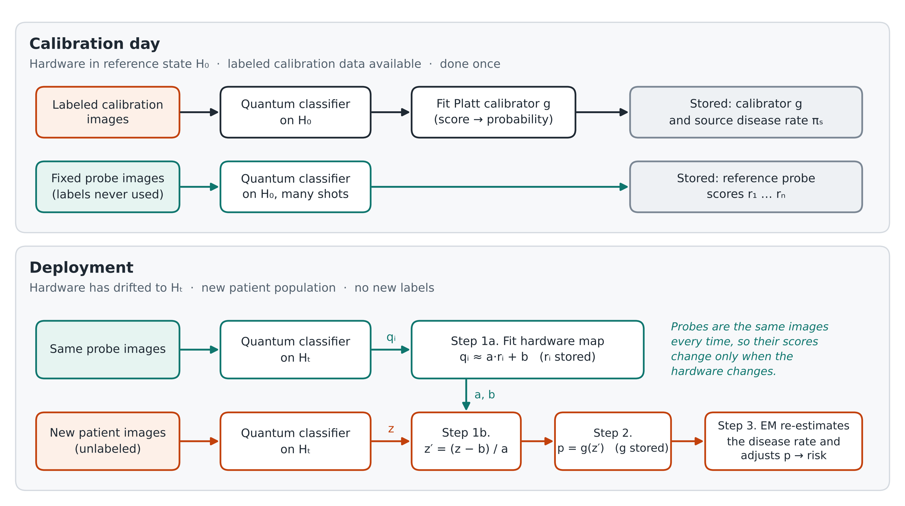

# SDQC: Shift-Disentangled Quantum Calibration

Code for **"Disentangling Quantum Hardware Noise and Distribution Shift for Reliable Confidence Calibration in Medical Image Classification"** (Taye Akinrele, The University of Alabama).

Hybrid quantum–classical classifiers produce scores that drift as hardware noise changes. At deployment the disease prevalence may also differ from the calibration set. With only unlabeled scores, the two effects are confounded. **SDQC** separates them:

1. **Calibration day:** fit Platt scaling on labeled data, and measure a small fixed set of *probe* inputs on the hardware.
2. **Deployment:** re-measure the same probes, fit an affine drift map `q ≈ a·r + b`, map patient scores back with `(z − b)/a`, and apply the frozen Platt calibrator.
3. Estimate the new prevalence with **shrunken EM** (λ = 0.85) and prior-adjust the probabilities.



## Repository layout

```
src/sdqc/
  config.py        experiment settings (paper defaults + --quick smoke test)
  data.py          MedMNIST download, frozen ResNet-18 features (GPU), splits, PCA-4 -> angles in [0, pi]
  circuits.py      VQC / re-uploading VQC / QSVM feature map, noise channels; CPU (NumPy) or GPU (PyTorch) simulator
  models.py        VQC, Re-uploading VQC, QSVM, MLP, RBF-SVM (+ V4 classical control)
  hardware.py      reference, training, held-out depolarizing and unseen amplitude-damping conditions
  calibration.py   metrics (Brier, NLL, ECE, AUROC) and baselines (Platt, EM, physics-informed, moment matching, ...)
  sdqc.py          SDQC itself (+ an `SDQC` class for use with your own model)
  experiment.py    one (dataset, seed) unit of the V5.1 benchmark
  analysis.py      every paper table, the paired cluster bootstrap and the hard-case figure
scripts/
  check_gpu.py         is the GPU visible, and is the GPU simulator faster than the CPU one?
  extract_features.py  download + cache ResNet-18 features
  run_experiment.py    full benchmark (parallel, resumable)
  analyze.py           rebuild tables / SUMMARY.md from a results folder
  draw_methodology.py  methodology figure (PDF + PNG)
  draw_intro.py        introduction figure (PDF + PNG)
  plot_v4_partB.py     V4 transfer figure from paper_results/v4 (PDF + PNG)
  slurm_gpu.sh         example cluster job
notebooks/           the original Colab notebooks (V4 benchmark, V5.1 SDQC)
paper_results/       v4 benchmark, the 3-seed Colab V5.1 run, and the 10-seed run used in the paper
paper/               paper source (main.tex) and vector PDF figures
tests/               unit tests (no download needed)
```

## Installation (local GPU machine)

```bash
git clone https://github.com/Racta-1/sdqc-quantum-calibration.git
cd sdqc-quantum-calibration
conda create -n sdqc python=3.11 -y
conda activate sdqc

# 1) PyTorch with CUDA. Choose the command for your driver from https://pytorch.org/get-started/locally/
pip install torch torchvision --index-url https://download.pytorch.org/whl/cu121

# 2) everything else
pip install -r requirements.txt
pip install -e .            # optional: makes `import sdqc` work anywhere

# 3) checks
python scripts/check_gpu.py
pytest -q
```

On Windows, run these commands in an *Anaconda Prompt*. They work the same way.

## Running

```bash
# Smoke test (a few minutes): 2 datasets, 1 seed, few hardware conditions
python scripts/run_experiment.py --quick --out results/quick

# Full paper configuration (3 datasets x 3 seeds x 29 hardware conditions x 4 prevalences)
python scripts/run_experiment.py --feature-device cuda --jobs 3 --out results/v5_1

# More seeds (recommended for a journal version)
python scripts/run_experiment.py --feature-device cuda --jobs 4 --seeds 0 1 2 3 4 5 6 7 8 9 --out results/v5_1_10seeds

# Probe-budget ablation, e.g. 16 probes
python scripts/run_experiment.py --probe-n 16 --out results/probe16
```

Options:

| Flag | Meaning |
|---|---|
| `--feature-device auto/cpu/cuda` | where the ResNet-18 feature extraction runs (default `auto` = GPU if available) |
| `--sim-device cpu/cuda` | where the noisy density-matrix circuits run (default `cpu`, as in the paper) |
| `--jobs N` | number of (dataset, seed) units run in parallel processes |
| `--datasets`, `--seeds`, `--probe-n` | override the experiment design |
| `--overwrite` | recompute units that already exist (runs are otherwise resumable) |
| `--legacy-report-stream` | reproduce the notebook bit-for-bit (see below) |

Outputs in `--out`:
- `metrics.csv`: one row per dataset × seed × model × hardware × prevalence × method
- `sanity.csv`
- `probe_diagnostics.csv`
- `tables/*.csv`: every table in the paper
- `SUMMARY.md`: all tables in one readable file
- `hard_case.pdf` / `hard_case.png`

### What the GPU speeds up

- **Feature extraction** (ResNet-18 on up to ~17k images at 224 px). This is the clear win. On CPU, OCTMNIST took about 30 minutes in Colab; a GPU typically brings this down to a few minutes.
- **Noisy circuits.** The circuits are only 4 qubits (16×16 density matrices). The GPU path (`--sim-device cuda`) gives identical results, but for batches this small it is not always faster than NumPy. Run `python scripts/check_gpu.py`: it times both paths and tells you which to use. On a multi-core machine, `--jobs` (parallel seeds/datasets) usually gives the biggest speed-up for the circuit part.
- VQC training (38 parameters, noise-free) always runs on CPU, because it is too small to benefit from a GPU.

## Reproducing the paper

`paper_results/v5_1/` holds the run reported in the paper. You can rebuild every table from it:

```bash
python scripts/analyze.py --results paper_results/v5_1
```

This reproduces the paper's Brier, NLL/ECE, per-model, by-prevalence, prevalence-error and probe tables. It also reproduces all 84 paired differences with their bootstrap confidence intervals, exactly.

Re-running from scratch:
- On the **same machine and library versions**, `--legacy-report-stream` gives results identical to the original notebook for every method.
- Without it, the randomly mis-reported device error rates come from an order-independent stream, so units can run in parallel. SDQC, Fixed Platt, EM, MM and the oracles are unchanged. Only the three baselines that use *reported* rates (noise-conditioned, physics-informed, physics-informed + EM) move slightly; in our check, their averages changed by ≤ 0.004 Brier.
- On a **different machine or library version**, model training can differ slightly, so expect small changes in every number. Conclusions should not change. Use more seeds to tighten the intervals.

## Using SDQC with your own model

```python
from sdqc import SDQC

# calibration day: labeled calibration scores + hardware scores of K fixed probe inputs
cal = SDQC(shrink=0.85).fit(z_cal, y_cal, probe_scores_calibration_day)

# deployment: unlabeled patient scores + the same probes re-measured today
p, info = cal.predict(z_today, probe_scores_today)
print(info["slope"], info["intercept"], info["estimated_prior"])
```

Set `use_em=False` when prevalence is known to be stable, or when the deployment batch is very small.

## Notes and limitations

- **Noise model.** All noise is simulated (depolarizing, amplitude damping, readout error, shots) and acts on every input in the same way. Validation on real hardware is future work.
- **QSVM.** The noisy kernel is a density-matrix proxy, `Tr(ρ_i ρ_j)`.
- **OCTMNIST.** This is a derived binary task, **CNV (1) vs NORMAL (0)**. The pooled train+val set is stratified-subsampled to 15,000 images.
- **Probe selection.** Probes are drawn uniformly at random, with a fixed seed, from the validation split.
- **Scope.** EM assumes pure label shift. Covariate shift, such as a new scanner, is not handled.
